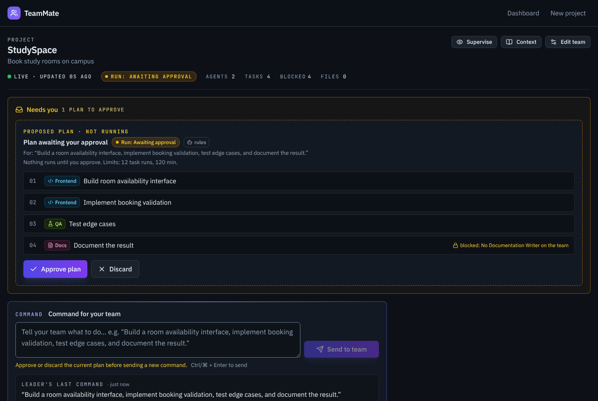
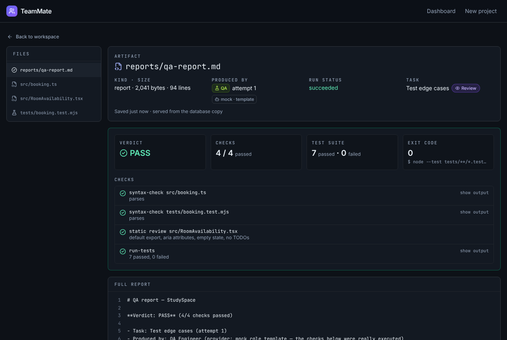
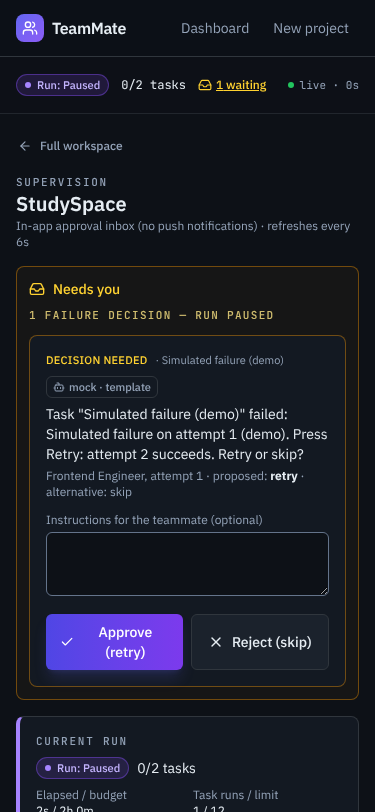

# TeamMate

[](https://hackoberfest-hack-day-dhaka.onrender.com/)

Submission for **HackOberfest Hack Day Dhaka**. Live demo: https://hackoberfest-hack-day-dhaka.onrender.com/ (hosted on Render's free tier: the first load after it has been idle can take up to a minute, and data resets when the service restarts).

TeamMate is a small web app for a hackathon team leader. You create a project, pick a few AI "teammates" (frontend, QA, docs, …), type one instruction in plain English, and the app splits it into tasks, assigns them, runs them, and shows you the files and test results that came out — with you approving the plan and answering questions along the way.


## The problem

During a hackathon, the team leader spends a lot of time turning one idea ("we need a booking page with validation and tests") into tasks, deciding who does what, and checking what actually got done. Chat-style AI tools help with single questions, but they don't keep track of a plan, who is working on what, what failed, or which files were produced.

We wanted to try the other shape: AI teammates that receive assigned tasks, write real files into a project folder, run real checks, and report back — while the leader stays in control of what runs.

## What it does

1. **Create a project** with a goal and constraints (e.g. "Book study rooms on campus", "React + TypeScript, no external services").
2. **Pick teammates** from six roles: Frontend Engineer, Backend Engineer, AI/ML Engineer, QA Engineer, Researcher, Documentation Writer.
3. **Give a command.** A planner splits it into ordered tasks and assigns each to a role. If a role isn't on the team, its task is kept but marked blocked ("No Documentation Writer on the team") instead of being dropped.
4. **Approve the plan.** Nothing runs until you click *Approve plan* (or *Discard* it).
5. **Watch it run.** Tasks execute one at a time. The Frontend role writes TypeScript files, QA syntax-checks them and runs the test suite for real, and Docs writes a README from the project's actual data.
6. **Supervise.** You can pause, resume or cancel a run. If a task fails, the run pauses and asks you: retry or skip? You can add instructions for the next attempt.
7. **Review.** Every file is viewable with line numbers, the QA report shows the verdict, test counts, exit code and raw output, and you approve finished tasks.

## Key features

- **Plan approval gate.** Commands create a run in `AWAITING_APPROVAL`; tasks stay blocked until you approve.
- **Real deliverables.** Files are written to a per-project folder on disk and also stored in SQLite, so the viewer still works if the folder is deleted.
- **Real QA.** QA only runs two allow-listed commands (`syntax-check`, `run-tests`), and its report includes the raw command output. The verdict is PASS only if every check passed.
- **Run limits.** Each run has a task limit (default 12 task runs) and a time limit (default 2 hours). Hitting one stops the run with a "Budget exhausted" message.
- **Failure decisions.** A failed task pauses the run and opens a retry/skip decision card in an in-app inbox (no push notifications).
- **Handoffs.** When a task finishes, a short message goes to the next teammate: which files are ready and a summary.
- **Mission map.** The workspace draws the leader, each agent's real task assignments and status, and dashed links only for handoff messages that were actually recorded. Tasks run in planner order; there is no dependency graph, and the map says so.
- **Activity stream and QA inspector.** Timestamped events with filters (tasks, tools, handoffs, decisions, files). The QA report view lists every check with its raw command output, and failed checks open automatically.
- **Mobile supervise page** at `/projects/:id/supervise`, built for a 375px-wide phone screen.
- **Survives restarts.** State is in SQLite. If the server stops mid-task, that task is marked `FAILED ("Interrupted by restart")` on the next start, and running runs pick up their queued work again.
- **Honest labels.** Output from the built-in templates is marked `mock · template` everywhere in the UI; nothing claims a model wrote it.

| Plan approval | QA report | Supervise (phone) |
|---|---|---|
|  |  |  |

## How much of this is AI?

**Planning: Gemma via Google AI Studio (model `gemma-4-26b-a4b-it`); agents run on a labelled mock provider; rule-based fallback on provider error.** The UI says which one planned each command: "Planned by Gemma (<model>)", "Rule-based plan — Gemma unavailable: <REASON>" (AUTH, RATE_LIMIT, TIMEOUT, BAD_JSON, SCHEMA, MODEL_NOT_FOUND, NETWORK, UPSTREAM), or "Rule-based plan (provider: mock)".

Being upfront about this, because it matters for judging:

| Part | Default (`AGENT_PROVIDER=mock`) | With `AGENT_PROVIDER=gemma` |
|---|---|---|
| Splitting a command into tasks | Rule-based planner (keyword scoring) | **Gemma** via Google AI Studio, with the rule planner as fallback |
| Frontend files | Role templates, filled in with the project name/goal and task title | same |
| Running checks and tests | Real — `node --check`, a TypeScript parse, and `node --test` | same |
| QA report | Real results and raw output | same |
| Docs README | Built only from stored project data (goal, constraints, decisions, results, file list, QA verdict) | same |
| Backend / AI-ML / Researcher | A placeholder note labelled as mock output | same |

So in this version **no model writes code**. The orchestration, tool sandbox, test execution, state machine and supervision are real; the code that gets written comes from templates. Gemma, when enabled, only does the planning.

## Architecture

```
client/   React 19 + Vite + Tailwind v4     polls GET /api/projects/:id/snapshot
server/   Express 5 + better-sqlite3 + Zod  run with tsx (no build step for the server)
shared/   types.ts — API types, task/run states and their allowed transitions
e2e/      Playwright browser tests
```

- **Planner** (`server/src/agents/planner.ts`): splits the command into clauses and scores each one against per-role keyword patterns. Nouns count more than verbs, so "implement booking validation" goes to Backend if you have one.
- **Orchestrator** (`server/src/agents/orchestrator.ts`): one loop per project that runs tasks in planner order. Before each task it re-reads the run and only continues if the run is `RUNNING` and within its limits. Claiming a task is a SQL compare-and-swap (`UPDATE … WHERE status = 'QUEUED'`), so a task can't run twice.
- **Tools** (`server/src/tools/toolbox.ts`): every file operation is confined to `server/workspace/<projectId>/`. Absolute paths and `..` are rejected. Agents can only run commands by name from a two-item allowlist, with a 15-second timeout. Every tool call is logged to the activity feed.
- **Task states**: `QUEUED → IN_PROGRESS → REVIEW → COMPLETED`, plus `BLOCKED` and `FAILED`. The leader can approve, unblock and retry, but can never set a task to `IN_PROGRESS`; illegal moves get `409`.
- **Run states**: `AWAITING_APPROVAL → RUNNING ⇄ PAUSED → COMPLETED / FAILED / CANCELLED`.
- **Storage**: SQLite in WAL mode with numbered migrations (`server/src/db/migrations.ts`).

## Prerequisites

- **Node.js 22.18 or newer** (`node -v`). QA runs the generated tests with Node's built-in TypeScript support, which older 22.x versions don't turn on by default — QA would correctly report FAIL there.
- npm (comes with Node).
- No database server, Docker, or API key needed for the default mode.

## Setup

```bash
git clone https://github.com/yunuszoro46-sketch/HackOberfest-Hack-Day-Dhaka.git
cd HackOberfest-Hack-Day-Dhaka
npm install
npm run dev
```

Open http://localhost:5173. The API runs on http://localhost:3001 and the dev UI proxies `/api` to it.

To run it as a single process (the API also serves the built UI):

```bash
npm run build
npm start
```

Then open http://localhost:3001.

The SQLite database is created automatically at `server/data/teammate.db`, and agent output goes to `server/workspace/`. Both are git-ignored. Delete them if you want a clean start.

## Environment variables

Everything is optional. Copy `.env.example` to `.env` in the project root only if you want to change something.

| Variable | Default | What it does |
|---|---|---|
| `AGENT_PROVIDER` | `mock` | `mock`: rule planner + templates, no network. `gemma`: Gemma plans, templates still execute. |
| `GEMMA_API_KEY` | — | Google AI Studio key, only for `gemma`. Sent only in the `x-goog-api-key` header. |
| `GEMMA_MODEL` | `gemma-4-26b-a4b-it` | A Gemma model id your key can access. Verified live on 2026-10-18: `gemma-4-26b-a4b-it` (~4–5s per plan) and `gemma-4-31b-it`. Gemma 4 is asked for minimal thinking; with default thinking it took 22–78s and exceeded the 12s limit. |
| `PORT` | `3001` | API port. |
| `TEAMMATE_DB` | `server/data/teammate.db` | SQLite file location. |
| `TEAMMATE_WORKSPACE` | `server/workspace/` | Where agents write files. |

If the Gemma call fails or takes longer than 12 seconds, the rule planner takes over, the plan is labelled `rules (fallback: gemma <REASON>)`, and a `planner.fallback` event appears in the activity stream. A Gemma plan still waits for your approval like any other plan.

## Tests

```bash
npm test            # 29 server tests (vitest): API, state machine, planner, sandbox, runs, decisions, full scenario
npm run test:e2e    # 3 Playwright browser tests; builds the UI and starts its own server on port 3100
```

On a fresh machine, Playwright needs a browser once: `npx playwright install chromium`.

The server tests include a full scenario test (`server/test/acceptance.test.ts`). It creates the demo project, approves the plan, checks the QA report says PASS with 7 passing tests, restarts the app on the same database with the workspace folder deleted, runs a failure + retry, and generates the docs.

## Demo walkthrough (about 4 minutes)

1. Landing page → **Build Your Team**.
2. Create **StudySpace** — goal "Book study rooms on campus", constraints "React + TypeScript, no external services".
3. Select **Frontend Engineer** and **QA Engineer** → *Continue to workspace*.
4. Click *Use demo command* (or paste): *Build a room availability interface, implement booking validation, test edge cases, and document the result.*
5. The plan appears with 4 tasks. Docs shows "blocked: No Documentation Writer on the team". Nothing has run yet. Click **Approve plan**.
6. Frontend writes the files, then QA runs the checks (watch the tool calls in the Activity panel). Open `reports/qa-report.md`: **PASS**, 7 tests passed, exit code 0.
7. **Approve** one task → it moves to Completed.
8. Stop the server (Ctrl+C), start it again, reload the page — everything is still there.
9. Open **Supervise** (also works on a phone). Send *simulate a failure* → **Approve plan**. The task fails on purpose, the run pauses, and a decision card appears. Pick **Approve (retry)**: attempt 2 succeeds and both attempts are kept. Or pick **Reject (skip)**: the run continues without it.
10. **Edit team** → add Documentation Writer → **Unblock** the Docs task → open `docs/README.md`, which is written from the project's real data.
11. Context page: add a decision and look at the command history with the planner label.
12. Optional, with a key: `AGENT_PROVIDER=gemma npm start` and repeat step 4. The planner badge then reads `gemma`.

"simulate a failure" is a deliberate demo hook: it adds a task that fails on its first attempt and succeeds on retry. The task description says so.

## API

`GET /api/health` · `GET /api/roles` · `GET|POST /api/projects` · `GET /api/projects/:id` · `GET /api/projects/:id/snapshot` · `PUT /api/projects/:id/agents` · `POST /api/projects/:id/decisions` · `POST /api/projects/:id/commands` (202; optional `maxTasks`, `maxRuntimeMs`) · `GET /api/projects/:id/tasks` · `GET|PATCH /api/tasks/:id` · `POST /api/tasks/:id/retry` · `GET /api/runs/:id` · `POST /api/runs/:id/approve|pause|resume|cancel` · `POST /api/decisions/:id` (`{action: "approve"|"reject", instructions?}`) · `GET /api/projects/:id/activity` · `GET /api/projects/:id/artifacts` · `GET /api/artifacts/:id` · `GET /api/activity/recent`

Errors always look like `{ "error": { "code", "message", "details?" } }`. Codes: `VALIDATION_ERROR` 400, `NOT_FOUND` 404, `INVALID_TRANSITION` / `NO_AGENTS` / `STALE` / `RUN_ACTIVE` 409, `EMPTY_PLAN` 422, `INTERNAL` 500.

## Known limitations

- No model writes code yet. Gemma only plans; execution always uses the role templates.
- Only Frontend, QA and Docs produce real output. Backend, AI/ML and Researcher write a labelled placeholder note.
- Tasks run one at a time in planner order. There's no dependency graph and no parallelism, and therefore no file locking.
- One active run per project. You have to finish, cancel or discard it before sending another command.
- The only kind of decision is "a task failed — retry or skip?". A task interrupted by a server restart doesn't open a decision; you retry it from the board.
- Instructions you attach to a decision are saved on the task and passed to the next attempt, but the templates don't use them.
- No plan editing after it's created. You can approve or discard it, not change it.
- QA's component check reads the `.tsx` file as text; it doesn't render or type-check it.
- Single user, no login. The UI polls every 2–6 seconds instead of using live push, and there are no push notifications.
- Don't run two server processes on the same database at once. The second one marks the first one's running task as interrupted before it fails to get the port.

## Future plans

Roughly in the order we'd tackle them:

1. Let Gemma (or another model) actually execute tasks through the same sandboxed tools, starting with the Frontend role.
2. Real output for the Backend and Researcher roles instead of placeholder notes.
3. Editing a plan before approval, and re-approval when it changes.
4. A simple dependency graph, so independent tasks could run in parallel.
5. Server-sent events instead of polling.

## Repository layout

```
client/src/pages/      Landing, Dashboard, CreateProject, Agents, Workspace, Supervise, Context, ArtifactView
client/src/components/ shared UI pieces (status badges, run/plan/decision panels)
server/src/agents/     roles, planner, orchestrator
server/src/providers/  mock provider + templates, Gemma planner
server/src/tools/      sandboxed file and command tools
server/src/db/         SQLite connection, migrations, queries
server/test/           vitest suites
e2e/                   Playwright tests
docs/screenshots/      screenshots taken from the running app
```
