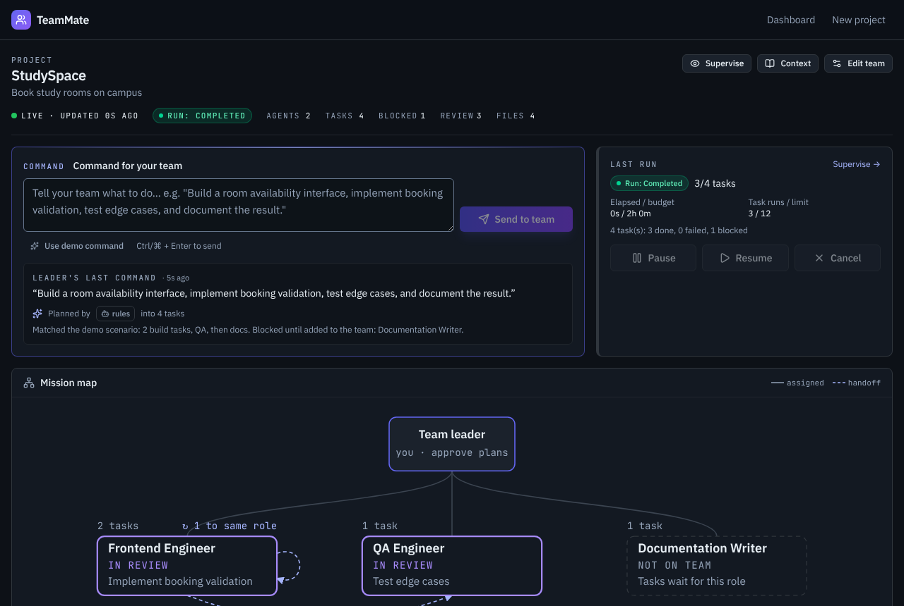

# TeamMate — Build With AI Teammates

**Don't just chat with AI. Build with AI teammates.**

TeamMate is a supervised AI development workspace built at **HackOberfest Hack Day Dhaka**. It explores a different way to work with AI: instead of getting a single answer from a chatbot, you give a project goal to a team of specialized AI teammates, review their plan, supervise execution, and inspect the resulting files and test reports.

<p align="center">
  <a href="https://hackoberfest-hack-day-dhaka.onrender.com/"><strong>🚀 Live Demo</strong></a>
  &nbsp; · &nbsp;
  <a href="https://github.com/yunuszoro46-sketch/HackOberfest-Hack-Day-Dhaka">Source Code</a>
  &nbsp; · &nbsp;
  <a href="https://github.com/yunuszoro46-sketch/HackOberfest-Hack-Day-Dhaka/issues">Report a Bug</a>
</p>

---

## The Problem

Building software involves more than writing code. Developers must break ideas into tasks, assign responsibilities, coordinate work, test results, and recover when something fails.

Traditional chat-based AI tools are useful for individual questions, but they don't necessarily provide a persistent workflow for managing tasks, tracking artifacts, or supervising execution.

**TeamMate explores a more structured approach:** a workspace where AI teammates receive assigned tasks, produce inspectable outputs, run permitted checks, and report their progress while a human stays in control.

## What You Can Do

- **Create projects:** Define a project goal and constraints.
- **Build a specialized team:** Choose from six roles—Frontend Engineer, Backend Engineer, AI/ML Engineer, QA Engineer, Researcher, and Documentation Writer.
- **Plan with natural language:** Turn a command into an ordered set of tasks.
- **Approve before execution:** Review a proposed plan before any task starts.
- **Supervise runs:** Pause, resume, or cancel execution.
- **Handle failures:** Review a failed task, provide additional instructions, and retry or skip it.
- **Inspect artifacts:** View generated files and review actual QA output.
- **Track team activity:** Follow task updates, recorded handoffs, decisions, files, and tool activity.
- **Continue after restarts:** Project state, tasks, artifacts, and activity are persisted in SQLite.
- **Use mobile supervision:** Monitor runs and manage decisions from a phone-sized interface.

## How It Works

1. **Create a project.** Set a goal and define constraints.
2. **Choose teammates.** Select the roles relevant to your project.
3. **Give a command.** Describe what you want the team to accomplish.
4. **Review the plan.** Inspect the proposed tasks and approve or discard the plan.
5. **Supervise execution.** Follow task status, activity, and recorded handoffs. Pause or resume the run when needed.
6. **Review the results.** Inspect generated files, QA verdicts, test counts, exit codes, and raw output.

The workflow is designed around human supervision: a proposed plan cannot execute until it is approved.

## See It in Action

The repository includes screenshots in `docs/screenshots/`. Add or update the images below to match the actual filenames in that directory.

<!-- Replace these paths with the exact screenshot filenames in docs/screenshots/. -->
<!--
<p align="center">
  
</p>
-->

Recommended screenshots:
- Workspace and agent mission map
- Plan approval and task board
- QA report and generated artifacts
- Mobile supervision interface

## How Much of This Is AI?

Transparency matters. TeamMate combines AI-assisted planning with a supervised execution system, but not every teammate currently generates code using an LLM.

| Capability | Default mode | Gemma planning mode |
|---|---|---|
| Task planning | Rule-based planner | Gemma, with rule-based fallback |
| Frontend artifact generation | Built-in templates | Built-in templates |
| QA execution | Real permitted checks and test commands | Same |
| QA report | Based on actual command results | Same |
| Documentation | Generated from stored project data | Same |
| Human approval and supervision | Supported | Supported |

**Important limitation:** Gemma is used for planning when configured and available; it does not automatically power every teammate. The current implementation uses templates for frontend artifacts, while other roles may produce placeholder outputs. Template-based outputs are labelled in the interface rather than being presented as live model-generated code.

The orchestration, persistence, approval flow, permitted tool execution, and QA reporting are separate from the model provider.

## Safety and Reliability

TeamMate includes several safeguards:

- Plans require human approval before execution.
- Tasks follow defined lifecycle transitions.
- Agent file operations are restricted to the project workspace.
- Command execution uses a limited allowlist.
- Tool activity and task outcomes are recorded.
- QA reports expose command output and report success only when the required checks pass.
- Run limits restrict task count and execution duration.
- SQLite persistence supports recovery after server restarts.

These are prototype-level safeguards, not a guarantee of complete isolation. Generated code is not protected by a dedicated operating-system sandbox, so use caution when running the application with sensitive files or credentials.

## Tech Stack

| Layer | Technology |
|---|---|
| Frontend | React 19, Vite, Tailwind CSS v4 |
| Backend | Node.js, Express 5 |
| Database | SQLite with `better-sqlite3` |
| Validation | Zod |
| Shared types | TypeScript |
| Browser testing | Playwright |
| AI planning | Optional Gemma integration through Google AI Studio |

## Getting Started

### Prerequisites

- Node.js **22.18 or newer**
- npm
- Git

The default mode does not require an API key or a separate database server.

### 1. Clone the repository

```bash
git clone https://github.com/yunuszoro46-sketch/HackOberfest-Hack-Day-Dhaka.git
cd HackOberfest-Hack-Day-Dhaka
```

### 2. Install dependencies

```bash
npm install
```

### 3. Start the development server

```bash
npm run dev
```

Open **http://localhost:5173** in your browser. The development API runs on port `3001`, and the frontend proxies API requests to it.

### 4. Run a production build

```bash
npm run build
npm start
```

The production server serves the built frontend and API. Check the terminal output for the local address.

### 5. Run tests

```bash
npm test
```

Use the repository's Playwright configuration and scripts for browser tests. Consult `package.json` for the available test commands.

## Optional Gemma Planning

TeamMate supports an optional Gemma-based planner. Without provider configuration, it uses the rule-based planner.

To enable Gemma:

1. Create an API key through [Google AI Studio](https://aistudio.google.com/apikey).
2. Review `.env.example` and the server's provider configuration to identify the exact supported environment variable names.
3. Configure the key and provider settings in your local environment or deployment secrets.
4. Restart the server and verify that the application reports successful Gemma planning rather than a rule-based fallback.

**Never commit API keys or expose them in frontend code.** If the provider is unavailable, the planner may fall back to rule-based planning.

## Project Structure

```text
HackOberfest-Hack-Day-Dhaka/
├── client/              # React frontend
├── server/              # Express API, agents, tools and SQLite
├── shared/              # Shared types and task/run states
├── e2e/                 # Playwright browser tests
├── docs/
│   └── screenshots/     # Project screenshots
├── .env.example         # Example configuration
├── package.json         # Scripts and dependencies
└── README.md
```

## Current Limitations

TeamMate is a working prototype, and some capabilities remain intentionally limited:

- Default agent outputs are template-based rather than fully LLM-generated code.
- Gemma is used for planning, not as an autonomous coding model for every role.
- Tasks execute sequentially rather than concurrently.
- Agent execution is restricted to a small set of permitted operations.
- The application does not provide a dedicated OS-level sandbox for generated code.
- Mobile supervision is an in-app interface, not a push-notification service.

These limitations define the current scope and provide clear directions for future development.

## Roadmap

Potential next steps include:

- Model-powered artifact generation for additional teammate roles
- Stronger isolation for executing generated code
- More sophisticated task dependencies and parallel execution
- Improved model-provider observability and retry handling
- Richer collaboration between specialized agents
- More advanced remote supervision and notifications

## Contributing

Contributions, bug reports, and practical suggestions are welcome.

1. Fork this repository.
2. Create a feature branch:

   ```bash
   git checkout -b feature/your-change
   ```

3. Make a focused change.
4. Run the relevant tests and verify the application.
5. Commit your work:

   ```bash
   git add .
   git commit -m "Describe your change"
   ```

6. Push your branch and open a pull request.

Please keep contributions focused, document behavior changes, and never commit secrets or private data.

## Credits

Built for **HackOberfest Hack Day Dhaka**.

TeamMate is an experiment in making AI-assisted software development more structured, observable, and human-supervised.

## License

A license has not been specified in this README. Add a `LICENSE` file and identify the chosen license before describing the project as licensed for reuse.
