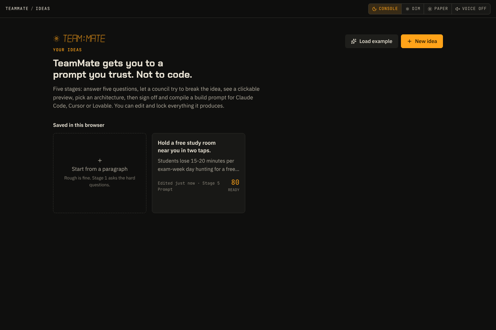
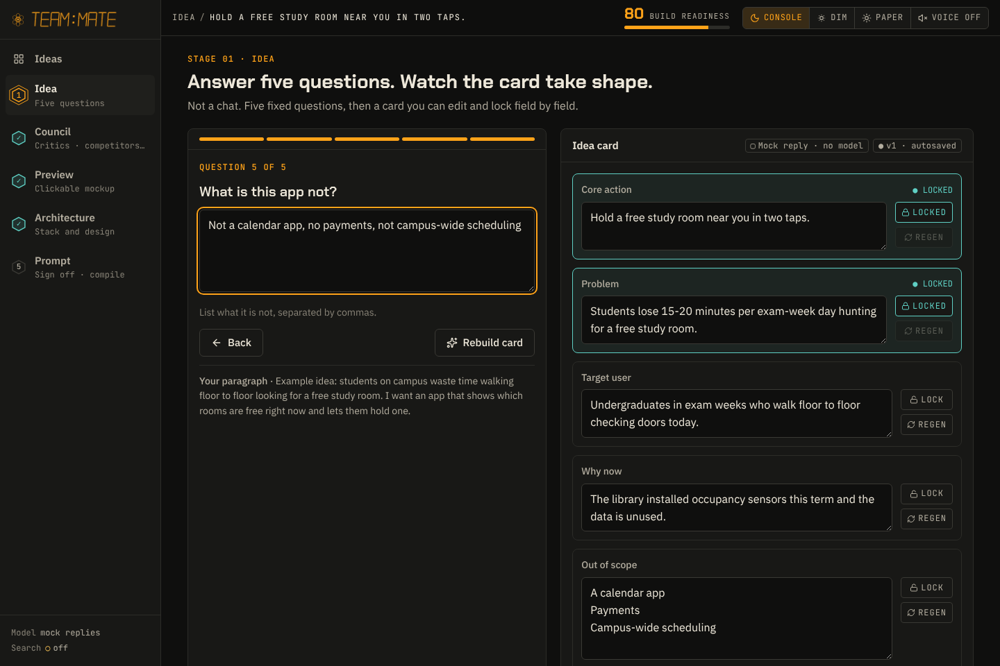
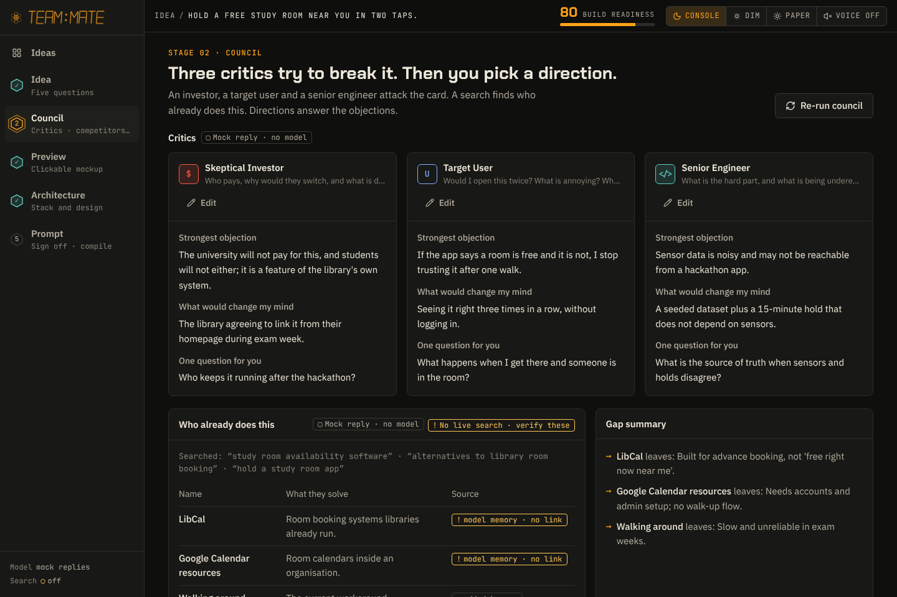
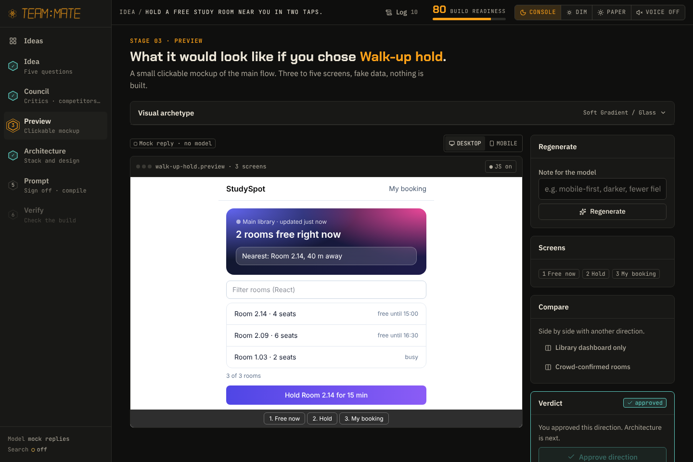
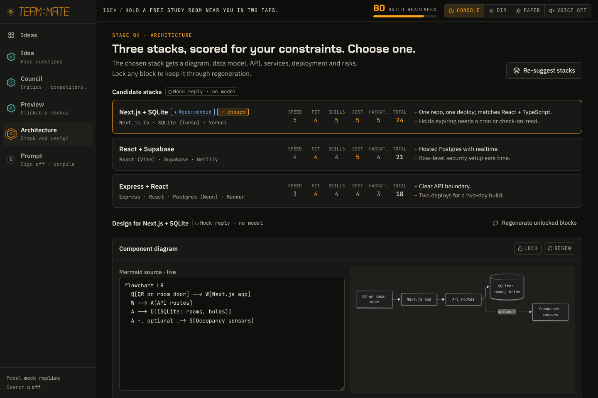
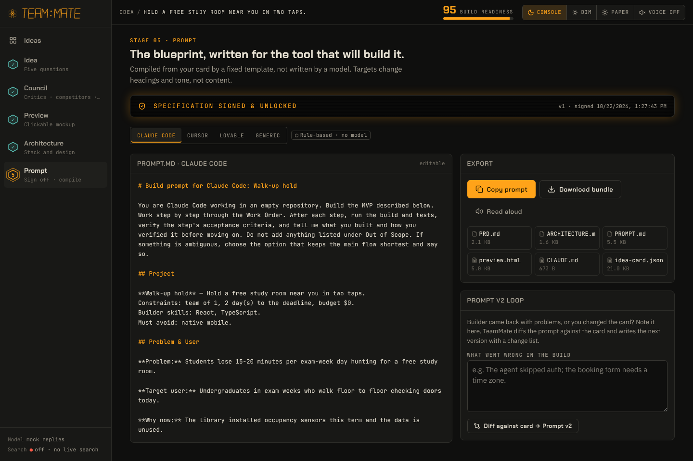
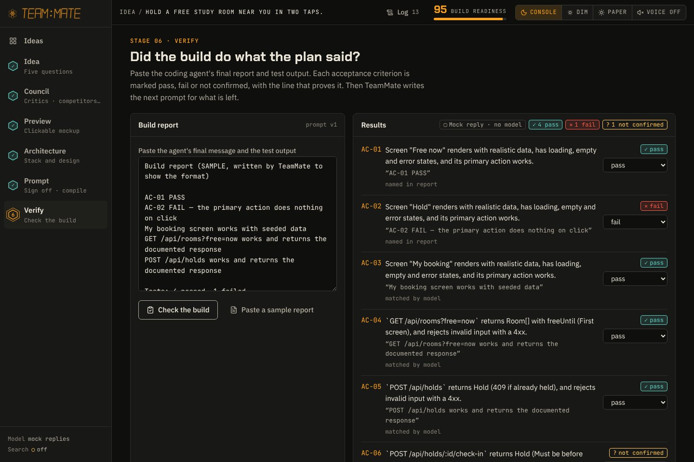
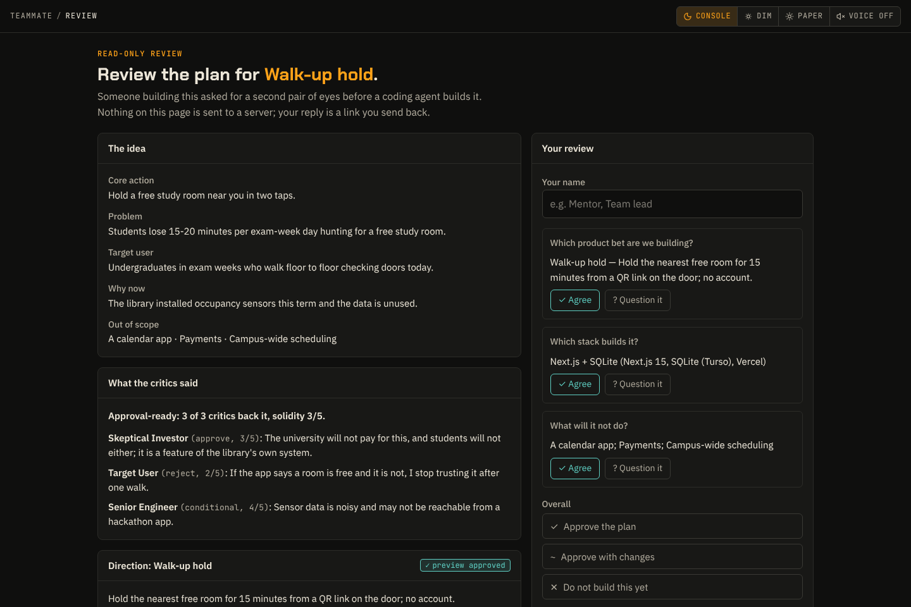

# TeamMate

**TeamMate gets you to a prompt you trust. Not to code.**

[](https://hackoberfest-hack-day-dhaka-1.onrender.com/) [](LICENSE)

**Try it:** https://hackoberfest-hack-day-dhaka-1.onrender.com/ (free hosting: the first visit after a quiet spell can take about a minute to wake up). No key needed to look around: click **Load example** on the home page.

Built for **HackOberfest Hack Day Dhaka** for hackathon participants and solo builders who have an idea but no team. TeamMate does not build your app. It:

1. **interrogates** the idea with five fixed questions,
2. lets a **council** of three critics attack it and **searches for real competitors**,
3. proposes **2–3 different product directions** and shows a **small clickable preview** of the one you pick,
4. helps you **choose an architecture** (scored stacks, diagram, data model, API, services, deployment, risks),
5. **compiles a build prompt** for Claude Code, Cursor, Lovable or your own hands, plus a downloadable bundle with acceptance tests,
6. **verifies the build**: paste the coding agent's report, see each acceptance criterion pass or fail with the line that proves it, and get the next prompt for what is left.

TeamMate is not another coding agent. It is the **supervisor** of one: the human decides and signs, the agent builds, TeamMate checks the result against the signed plan and writes the fix-up prompt. Every decision lands in a **decision log**, and a mentor can review the plan from a **read-only link** without an account.

Everything TeamMate produces is **editable and lockable**. A locked field is passed downstream verbatim and is never regenerated. Every generated block carries a **provenance badge** (model, source-verified search, rule-based, mock, or locked by you), and nothing is compiled until a human **signs off** the three decisions the plan rests on.

| | |
|---|---|
|  |  |
| **Ideas.** Saved cards with readiness and stage. | **1 · Idea.** Five fixed questions; the card fills as you answer. |
|  |  |
| **2 · Council.** Three critics, competitors with a gap summary, directions. | **3 · Preview.** A sandboxed clickable mockup and a verdict. |
|  |  |
| **4 · Architecture.** Scored stacks; lockable diagram, data model, API. | **5 · Prompt.** Signed, compiled, exported; a v2 loop for rework. |
|  |  |
| **6 · Verify.** Each criterion pass/fail with evidence; one click to the fix prompt. | **Review link.** A mentor reviews the plan read-only and replies with a link. |

Screenshots are from the example idea in the `console` theme (`npm run screenshots`).

## Demo path (about 90 seconds)

1. Home → **New idea** → paste a paragraph. To skip waiting on the model, click **Load example** instead.
2. Answer the five questions; the card fills in as you go. **Build card**, then **lock** "Core action".
3. **Run Council**: three critiques, each with a verdict (approves, only if answered, rejects) and a 1–5 solidity score; an overall line says whether the idea is **approval-ready** or who blocks it. A competitor table (with real links when `TAVILY_API_KEY` is set) with a gap summary, and three direction cards. Tick one: a direction that cites a critic answers that critic, and the verdict updates.
4. **Preview this direction**: click through the screens, regenerate with the note "mobile-first", compare another direction, then **Approve direction**.
5. **Architecture** → choose the recommended stack: the diagram, data model with SQL, and API table appear.
6. **Sign off and compile** → the **Human Sign-Off Checkpoint** lists the product bet, the stack and what is out of scope (plus the council verdict) → **Sign and compile** → toggle the target → **Copy prompt** → **Download bundle**: PRD.md, ARCHITECTURE.md, PROMPT.md, preview.html, CLAUDE.md, ACCEPTANCE.md, `tests/acceptance.spec.ts` (one Playwright test per AC id), DECISIONS.md and idea-card.json.
7. Give the prompt to the coding agent. Its work order ends with a report: one line per criterion, `AC-01 PASS` or `AC-01 FAIL — reason`.
8. **Verify**: paste that report (or **Paste a sample report** to try it) → **Check the build**. Lines naming an AC id decide first; a model matches the rest and must quote the report, or the criterion stays "not confirmed". → **Write prompt v3 for these**: the next prompt leads with "Fix these first".
9. **Log** (top bar) shows every decision. **Share for review** (Prompt stage) makes a read-only link; the reviewer agrees or questions each decision and sends back a reply link that adds their review to the idea.

The top-right **Build readiness** score (0–100) rises as you go: lock 3+ fields 15, council run 20, direction picked 15, preview approved 20, stack chosen 15, prompt compiled 15. A stale stage counts half. Hover it to see each contributor.

## Setup

Requires Node.js 22.18 or newer (the contrast check runs TypeScript directly).

```bash
npm install
cp .env.example .env.local   # add your keys
npm run dev                  # http://localhost:3000
```

To try it with no keys at all, set `LLM_PROVIDER=mock`. Every stage then returns canned replies built from what you typed, and the UI labels them **mock replies**.

### Environment variables

| Variable | Default | What it does |
|---|---|---|
| `LLM_PROVIDER` | `gemma` | `gemma`, `gemini`, or `mock` (canned replies, no key needed). |
| `GEMINI_API_KEY` | — | Google AI Studio key, used by both Gemma and Gemini (`GOOGLE_API_KEY` also works). |
| `GEMMA_MODEL` | `gemma-4-26b-a4b-it` | Gemma model name. |
| `GEMINI_MODEL` | `gemini-2.5-flash` | Gemini model name. With `LLM_PROVIDER=gemini`, competitor research can use Google Search grounding. |
| `TAVILY_API_KEY` | — | Live web search for competitors. Without it, Stage 2 shows a labelled "no live search" fallback instead of failing. |
| `RATE_LIMIT_PER_10_MIN` | `30` | Requests per IP per 10 minutes on the stage routes. |

All keys stay on the server. The browser never sees them. `GET /api/health` reports the provider, the model, and whether search is configured.

### Deploy

**Render (blueprint included).** In Render: **New → Blueprint**, pick this repository, and it reads `render.yaml`:

- build: `npm ci --include=dev && npm run build` (dev packages are needed for Tailwind, TypeScript and the contrast check)
- start: `npm start` (binds `0.0.0.0` on Render's `PORT`)
- health check: `/api/health`
- Node `22.22.0` (also pinned in `.node-version`)

Render asks for `GEMINI_API_KEY` (required for real model output) and `TAVILY_API_KEY` (optional, live competitor search). To demo with no keys, set `LLM_PROVIDER=mock`. On the free plan the service sleeps when idle, so the first request after a pause takes about a minute.

Manual setup works too: a Node web service with the same build and start commands and the variables from `.env.example`.

**Vercel.** Import the repository and set the same environment variables; no other configuration is needed. Stage routes set `maxDuration = 60`.

### Checks

```bash
npm run typecheck
npm run test         # Vitest: schemas, readiness, staleness, store, adapter retry, every stage route, sanitizer, compiler, bundle
npm run build        # runs npm run contrast first: fails if any theme pair is below WCAG AA
npm run test:e2e     # Playwright: idea to verified build to review, the error UI with no key, 390/400px no-horizontal-scroll
npm run screenshots  # refreshes docs/screenshots/
```

The browser tests build once and start two servers: one with mock replies for the demo path, and one with Gemma and no key to check the error panels.

## Architecture overview

```
app/
  page.tsx                       Ideas home: card grid, start from a paragraph, example, duplicate, inline delete
  idea/[id]/page.tsx             The workspace: stepper rail, top bar, the five stages
  api/health/route.ts            Provider + search status
  review/page.tsx                Read-only review page for a shared plan (data comes from the link fragment)
  api/stage/<name>/route.ts      interrogate · council · competitors · directions · preview · architecture · verify
components/stages/               Workspace shell, the six stage screens, the share/review panel
components/console/              Design-system pieces: Panel, Chip, LockableField, ProvenanceBadge, StepperRail, TopBar,
                                 ReadinessMeter, StageStatus (running line, skeleton, error, empty), Toast, MermaidView,
                                 hexagon identity, segment displays, visual archetypes
components/ui/                   shadcn/ui primitives (button, dialog, collapsible, tooltip), restyled to the tokens
scripts/contrast.ts              WCAG contrast gate over the three themes
lib/
  schema/ideaCard.ts             The Idea Card (Zod) and Lockable<T>; the spine of the app
  stale.ts                       Stage fingerprints → "stale" banners and "Regenerate stale"
  readiness.ts                   Build-Readiness score, computed (never from a model)
  signoff.ts                     Human sign-off: the three decisions and the plan fingerprint the signature covers
  verdict.ts                     Council verdict: approval-ready, not yet, or blocked (computed, never from a model)
  verify.ts                      Build-report checking: rules for AC ids, model only for the rest, quotes required
  log.ts                         Decision log, derived by diffing the card on every change; DECISIONS.md
  share.ts                       Share and reply links: compressed, validated, carried in the URL fragment
  archetypes.ts                  Visual archetypes for the preview and the prompt's visual section
  store/                         IdeaStore interface, localStorage implementation, Supabase stub
  llm/adapter.ts                 generate() / generateHtml(): Zod validation, one retry with the error, then 422
  llm/gemma.ts, gemini.ts, mock.ts   Providers (google.ts wraps @google/genai)
  prompts/<stage>.ts             One prompt template per stage; compile.ts is the template-filled prompt compiler;
                                 v2.ts diffs a prompt against a fresh compile for the Prompt v2 loop
  preview/sanitize.ts            Preview HTML sanitizer
  search/tavily.ts               Competitor search
  export/bundle.ts               Files in the download bundle
  export/acceptance.ts           ACCEPTANCE.md and tests/acceptance.spec.ts from the acceptance criteria
  prompts/fix.ts                 The fix-up prompt written from a build check
  seed/exampleIdea.ts            The example idea
```

- **One Idea Card.** Every stage receives only the card (never chat history) and returns a Zod-validated patch. Locked values go into prompts as fixed facts. The server leaves them out of patches, and the client refuses to overwrite them.
- **Staleness.** When a stage runs, it stores a fingerprint of its upstream inputs. Editing an upstream field changes that fingerprint, so the downstream stages show as stale in the stepper and banner, and **Regenerate stale** re-runs them in order. Locked fields, your own directions and your chosen direction survive regeneration.
- **Model output** is always parsed with Zod. A bad reply is retried once with the parse error appended. A second failure returns 422 with the raw text, which the UI shows in a collapsible panel next to Retry.
- **Competitor URLs** are never typed by the model. It picks search results by number and the server copies those results' URLs. With Gemini grounding, a URL is kept only if its site came back from the search. Otherwise the entry is marked "model knowledge" and has no link.
- **Previews** are real front-end mockups: Tailwind, custom CSS (gradients, glass, keyframe animations), small JavaScript interactions, and one React component written with [htm](https://github.com/developit/htm) (no JSX, no build step). The example and the mock replies show all four.
  - **Rebuilt from an allow-list.** Unknown tags and attributes, `on…=` handlers, `javascript:` links, frames, external images, stylesheets and fonts, and CSS `url()`/`@import`/`expression()` are removed.
  - **Model scripts.** Up to four inline scripts (40 KB) are kept, tagged so the **JS on/off** switch on the frame can remove them. External `<script src>` is never kept. A script that navigates, opens windows, reaches the parent page, uses storage or cookies, calls `eval`/`Function` or opens dialogs is dropped and reported. That check is a heuristic on top of the next two layers, not a replacement.
  - **No network.** A Content-Security-Policy allows scripts only inline and from TeamMate's own `/preview-vendor/` (Tailwind 4.3.3 browser build, React 18.3.1, ReactDOM 18.3.1, htm 3.1.1, pinned and committed; `node scripts/vendor-preview.mjs` refreshes them), and sets `connect-src 'none'`, `img-src data:`, `form-action 'none'`.
  - **Sandboxed.** Shown in `<iframe sandbox="allow-scripts">`: no same-origin access, no popups, no modals, no top-level navigation. Links inside the preview are kept inside it. The exported `preview.html` loads the same pinned versions from jsDelivr.
- **Prompt compiler.** A fixed template with sections from Project through Risks to Watch. The four targets change headings and tone, not content. It's deterministic: the same card always gives the same prompt.
- **Hygiene.** Per-IP in-memory rate limit, one JSON log line per model call (stage, provider, latency, tokens, outcome; never prompts or keys), loading states that name the running stage and its elapsed seconds, and autosave on every change.

## Design system

The look follows the TeamMate design prompt: a dark instrument console with one amber accent.

- **Three themes** (`console`, `dim`, `paper`) are CSS custom properties on `<html data-theme>`, saved in localStorage and applied before first paint. Tailwind reads them through `@theme` in `app/globals.css`, so components never use raw palette colours.
- **Visual archetypes** now include **Soft Gradient / Glass** (gradient washes, frosted cards, gradient primary button) next to Hardware Console, Bento Grid, Monospace and Editorial. The example idea uses it.
- **Readability over the spec's exact values.** Dim's text and accents are brighter than the spec (its secondary text was hard to read), Console's and Paper's secondary greys are a step stronger, and `paper --amber` is `#A06000` (the spec's `#B86E00` gave 3.7:1 for button text). Every pair still passes the contrast gate.
- **Type.** Body text is 16px IBM Plex Sans; labels, section headings and buttons use the same plain face (no spaced uppercase). Chakra Petch is kept only for page titles, the question and the readiness number; JetBrains Mono for data, chips and code. Fonts are self-hosted with `@fontsource`, because Google Fonts was blocked in the build environment.
- **Status is never colour alone**: chips carry a symbol (`✓ ! ✕ ⊙ ●`) and text; avatars carry `$`, `U`, `</>`.
- **Glow and scanlines only on `.lcd-display`** (the signed readout). Loading uses skeletons and a running line, never spinners. No `alert`, `confirm` or `prompt`; confirmations are inline.
- **Keyboard:** a 2px amber focus ring everywhere; keys 1–5 jump between stages on the rail; Enter picks a focused direction card.
- **Theme and Voice controls** live in the top bar (and in the Console sheet below 1024px). Voice reads stage results aloud when on; **Read aloud** on the prompt works regardless.

## Supervision features

- **Council verdict.** Each critic returns a verdict and a solidity score with their critique. The overall line is computed: blocked while any critic rejects and no chosen direction answers them; approval-ready when at least two critics back it and average solidity is 3 or more.
- **Acceptance tests in the bundle.** Criteria get ids (AC-01 …). `tests/acceptance.spec.ts` has one Playwright test per id: endpoint tests run as written (valid route, invalid input rejected with a 4xx, never a 5xx); screen tests carry a TODO the agent fills in. The prompt says never to delete a test.
- **Verify (stage 6).** A report is judged per criterion with quoted evidence. Rules read lines that name an id (also test-runner lines such as `✘ … AC-02`); only the remaining criteria go to the model, and a model verdict without a quote that really appears in the report is discarded. Without a model key, rule results still work and the rest stay "not confirmed". You can override any status. A newer prompt marks the stage "re-check".
- **Decision log.** Locks, picks, approvals, stack, sign-off, prompt versions, build checks, reviews and council verdict changes are recorded automatically by comparing the card before and after each change. Text edits are not logged.
- **Review without accounts.** The share link carries the plan compressed in the URL fragment (after `#`), which browsers do not send to servers. The reviewer page validates it, re-sanitizes the preview and shows it read-only. The reply is another link; opening it on the builder's browser offers to add the review and notes if the plan changed since.

## Choices made where the spec was open

- **Default model is `gemma-4-26b-a4b-it`**, the model verified on this project's AI Studio key, instead of `gemma-3-27b-it`. Change it with `GEMMA_MODEL`. Gemma 4 runs with minimal thinking so each call takes seconds.
- **Stage 2 is three routes** (`council`, `competitors`, `directions`) that the client calls in order. Each stays well inside serverless time limits, and the UI shows which part is running.
- **Mock provider.** `LLM_PROVIDER=mock` exists so the demo, the tests and anyone without a key can run the whole flow. Its output is always labelled.
- **Structured architecture blocks** (data model, API, services, risks) are edited as JSON, validated by the same Zod schemas the model output must pass. The diagram, the deployment fields and all text fields are edited inline. The SQL is derived from the data model by code.
- **Your direction survives regeneration.** Re-running directions keeps both your own directions and the one you picked; only the others are replaced.
- **Rate limits and saved reviews are per server instance and in memory**, which is fine for a demo. Ideas live in this browser's localStorage, and a Supabase store is stubbed behind the same interface.
- **Six stages, not five.** Verify was added after the design prompt, to close the loop from prompt to checked build.
- **The design prompt's file paths** (`client/src/...`) are from the earlier Vite app; the design was applied to this Next.js app instead, since the build prompt decides scope.
- **Sign-off covers three decisions** (product bet, stack, out of scope). Editing any of them later voids the signature, and the prompt shows "Sign again".
- **Preview approval** is per direction: picking another direction or regenerating its preview clears it.
- **The example idea** is labelled as mock output everywhere (it is hand-written, not from a model).
- **shadcn/ui components were added from shadcn's source by hand**, because the shadcn registry host was blocked in the build environment. They are standard shadcn components (`components.json` is included).

## Not built (on purpose)

Code generation, deploying your app, multi-user teams, authentication, cloud persistence (the interface only), a command palette, agent orchestration, ops/incident features, more than 3 directions or 5 preview screens, and chat-style conversation at any stage.


## License

[MIT](LICENSE) © 2026 yunuszoro46-sketch. The browser libraries in `public/preview-vendor/` (React, ReactDOM, htm, Tailwind) are MIT-licensed by their authors; versions are listed in `VERSIONS.txt` there.
